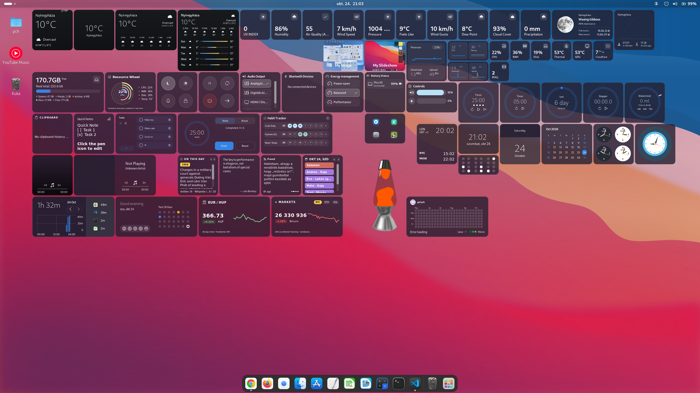

# Grid Desktop

A high-performance desktop widget ecosystem and icon manager for GNOME Shell, powered by a screen-adaptive canvas grid and pure Clutter rendering.



---

### Core Architecture & Highlights
- **Dynamic Grid Scaling**: Automatically adapts cell sizing and layout to any display resolution and aspect ratio — full native support for standard 16:9 displays and Ultrawide (21:9 / 32:9) monitors.
- **Smart Multi-Monitor Support**: Cleanly handles display topology changes (docking, undocking, laptop lid open/close) across Wayland and X11 sessions, with per-widget monitor pinning (e.g. pinned to Primary Monitor or Follow Global).
- **Precision Alignment & Grid Overlay**: Snap-to-grid placement with dynamic collision avoidance and interactive resizing across up to 3 widget sizes. Includes a toggleable on-screen grid overlay to make layout designing effortless.
- **Pure Clutter Engine**: High-performance, lightweight rendering directly via Clutter without external CSS dependencies, built for GNOME 48, 49, 50, and 51.
- **Integrated Desktop Icon Manager & Context Actions**:
  - Native desktop icon support snapped cleanly to the adaptive grid with custom alignments (Left/Right) and orientation (Vertical/Horizontal)
  - Native desktop context menu with **Paste to Desktop** functionality for file clipboard transfers
  - Toggle icon labels, auto-layout reorganization, and quick shortcuts for Home, Trash, and mounted/network drives
- **Modernized Libadwaita Preferences**:
  - Fully overhauled settings window utilizing native `Adw.PreferencesRow` and `Adw.ActionRow` lists rather than cluttered card layouts
  - Streamlined appearance controls: unified system theming, Adwaita light/dark support, and curated color palettes without redundant styling overrides where they don't belong
  - Global and selective per-widget styling (background color, 0–100% opacity slider, custom typography)
- **Dedicated Insights & Data Export**: Built-in tracking hub with detailed day-by-day breakdowns for active Screen Time and Mood trends, featuring one-click JSON data export.

---

### Widgets & Customization Options

#### System Monitor & Hardware
*Comprehensive hardware telemetry, package tracking, and desktop power utilities.*

- **Hardware Info**: Complete system and hardware overview summarizing CPU model, GPU architecture, total memory, motherboard, and core specs.
- **System Uptime**: Live runtime counter displaying total machine uptime and last boot time.
- **System Updates**: Real-time package update checker tracking pending system updates (APT, DNF, Pacman, Flatpak) directly on the desktop canvas.
- **System Dashboard**: All-in-one system overview tracking CPU history, temperature, active tasks, network traffic, and RAM usage.
- **System Monitor**: Dual real-time graph monitor displaying CPU and RAM resource utilization side-by-side.
- **Storage Bar**: Visual multi-category disk breakdown (System, Media, Archive, Docs, Free space) with support for targeting custom paths and partitions.
- **Resource Wheel**: Circular hardware telemetry dial summarizing CPU, RAM, Disk, and Temperature status.
- **System Info**: Modular glance tile displaying an individual system metric with an optional trend chart (CPU Usage, RAM Usage, Disk Usage, Thermal CPU, GPU Temp).
- **Network Speed**: Real-time upload and download throughput monitor with traffic trend lines.
- **Ping Monitor**: Live latency monitor showing response times and server connectivity status.
- **Quick Toggles**: Fast access toggles for Dark Mode, Night Light, Do Not Disturb (DND), and screen lock.
- **Power Controls**: Quick power management buttons for suspend, reboot, shutdown, and logout.
- **Power Profiles**: One-click switcher for system power management modes (Power Saver, Balanced, Performance).
- **Battery Status**: Unified charge monitor tracking laptop battery percentage and charging state alongside connected Bluetooth peripherals.
- **Audio Output**: Fast device switcher to toggle between connected audio sinks (Analog, S/PDIF, HDMI/DisplayPort, Bluetooth).
- **Control Sliders**: Interactive on-canvas sliders for master audio volume and display brightness.
- **Bluetooth Devices**: Live list of connected Bluetooth peripherals with device-type icons, battery levels, and one-click disconnect.

#### Productivity, Files & Organization
*Desktop workflow, task management, file quick-look, and productivity enhancement tools.*

- **Folder Preview**: Interactive desktop directory viewer allowing quick browsing, file peeking, and fast launching of files directly from selected local folders.
- **Pomodoro Timer**: Full focus timer featuring circular progress visualization, dedicated work and break cycle tracking, and playback/reset controls.
- **Pomodoro Focus**: Compact horizontal focus tracker with one-click mode switching (Work/Break), session completion counter, and start/reset controls.
- **Tasks**: Streamlined to-do checklist with a pending task counter, checkable completion states, quick task creation, and item deletion.
- **Quick Notes**: Direct markdown sticky note scratchpad on the desktop canvas with an inline edit mode for notes and checklist items.
- **Clipboard History**: Quick-access local clipboard manager showing recent copied text snippets for fast reference and reuse.
- **App Launcher**: Compact desktop dock providing one-click launch access for up to 8 installed applications.
- **Mail**: Displays unread emails across all connected GNOME Online Accounts.

#### Media & Imagery
*Dynamic desktop media playback controls, turntable animations, and visual display tiles.*

- **Music Player**: Compact media player featuring album artwork, track details, and playback controls. Features a vintage vinyl turntable view with an animated tonearm synchronized to track playback and seeking, alongside a real-time fluid audio spectrum visualizer (CAVA / 16-Bar Equalizer).
- **Music Player (Wide)**: Expanded horizontal layout displaying album artwork alongside track info, artist details, and playback controls. Automatically adapts its background accent to match the active album artwork palette.
- **Image / GIF**: Displays static images or animated GIFs directly on the desktop grid, with support for custom image captions.
- **Image Slideshow**: Cycles smoothly through local images from a selected folder using crossfade transitions, with support for captions.

#### Weather & Sun
*Comprehensive Open-Meteo powered weather tracking with dynamic visuals and modular metrics.*

- **Weather Standard**: Clean weather tile showcasing current sky conditions, temperature, and daily high/low.
- **Weather Minimal**: Focused, minimal tile displaying current temperature and location.
- **Weather Forecast**: Expanded layout featuring current conditions alongside an hourly forecast breakdown.
- **Weather Daily Bars**: Multi-day extended forecast with visual temperature range bars.
- **Solar Schedule**: Visual day/night curve showing real-time sun progression, sunrise, sunset, and remaining daylight hours.
- **Moon**: Current lunar phase and upcoming phases with illumination tracking.
- **Weather Cards**: Modular glance cards that can be placed independently to monitor a specific environmental metric with an optional trend chart (UV Index, Humidity, AQI, Wind Speed, Pressure, Feels Like, Wind Gusts, Dew Point, Cloud Cover, Precipitation).

#### Time & Calendar
*Precision desktop timekeeping, global clocks, countdowns, and schedule trackers.*

- **Time & Date**: Clean digital clock displaying the current time and full date.
- **Analog Clock**: Fully customizable vector analog clock with a smooth sweeping second hand. Supports SVG-based clock skins (Basic, Community, Osx, Rolex, Sensa), custom dial artwork, and standalone floating clock face mode.
- **World Clock**: Multi-city digital clock showing live times across global timezones simultaneously.
- **World Analog Clock**: Quad analog dial layout displaying multiple timezone clocks in a single unified widget.
- **Calendar**: Classic single-day calendar page showing the current day and month with today highlighted and month navigation controls.
- **Month Calendar**: Compact month grid view highlighting current dates and color-coding weekends.
- **Timer**: Simple countdown timer widget with progress tracking and pause/reset controls.
- **Countdown**: Target date and deadline countdown tracker displaying remaining days and time within a circular progress gauge.
- **Stopwatch**: Clean desktop stopwatch with elapsed time display and playback controls.
- **Binary Time**: A clean BCD binary clock display.

#### Personal & Tracking
*Habit formation, market tracking, daily wellness, and informational feeds.*

- **Currency Tracker**: Live foreign exchange rate tracker featuring a 30-day historical trend chart powered by Frankfurter API.
- **Crypto Tracker**: Live cryptocurrency price tracking for major assets (BTC, ETH, SOL) with a 24h market trend line powered by CoinGecko.
- **GitHub Activity**: Desktop GitHub contribution heat map showing profile avatar, yearly total contributions, and sync status.
- **Habit Tracker**: Routine and habit tracker designed to log daily achievements, record streaks, and measure progress over time.
- **Watermind**: Smart hydration tracker operating across an 8-hour daily active window with quick-log presets.
- **Mood Logger**: Daily emotional wellbeing tracker logging moods with visual color progression across the previous four weeks.
- **Screen Time**: Active desktop session monitor with a time-of-day bar chart and application breakdown.
- **Today in History**: Daily historical milestones and notable events fetched directly from Wikipedia.
- **RSS Headlines**: Compact, auto-rotating news reader displaying article summaries and headlines from custom RSS feeds.
- **Quotes**: Daily inspirational quotes from philosophers, programmers, and thinkers updated automatically.
- **Calendar Tasks**: Aggregated daily agenda widget displaying today's scheduled events from synchronized calendars.
- **LavaLamp**: Ambient decorative lamp with fluid wax metaball animations.

---

## Compatibility

- **GNOME Shell:** 48, 49, 50, 51 
- **Display Server:** Wayland (recommended) & X11

---

## Manual Installation

1. **Clone the repository:**
   ```bash
   git clone https://github.com/pelach/grid-desktop.git
   cd grid-desktop
   ```

2. **Install to GNOME Extensions directory:**
   ```bash
   mkdir -p ~/.local/share/gnome-shell/extensions/grid-desktop@pelach.github.com
   cp -r * ~/.local/share/gnome-shell/extensions/grid-desktop@pelach.github.com/
   ```

3. **Compile GSettings schemas:**
   ```bash
   glib-compile-schemas ~/.local/share/gnome-shell/extensions/grid-desktop@pelach.github.com/schemas/
   ```

4. **Restart GNOME Shell:**
   - **X11:** Press `Alt + F2`, type `r`, and press `Enter`.
   - **Wayland:** Log out and log back in.

5. **Enable the extension:**
   ```bash
   gnome-extensions enable grid-desktop@pelach.github.com
   ```

---

## Development and Debugging

To monitor extension logs in real-time:
```bash
journalctl -f -o cat /usr/bin/gnome-shell | grep -E "grid-desktop|DesktopGrid"
```

To recompile schemas locally during development:
```bash
glib-compile-schemas schemas/
```

---

## Acknowledgments
Based on the original Gridgets extension by rebatnaath.  
Refactored, enhanced, and maintained by András Pelach (with development assistance from Google Gemini).

## License
This project is licensed under the GPL-3.0 License.